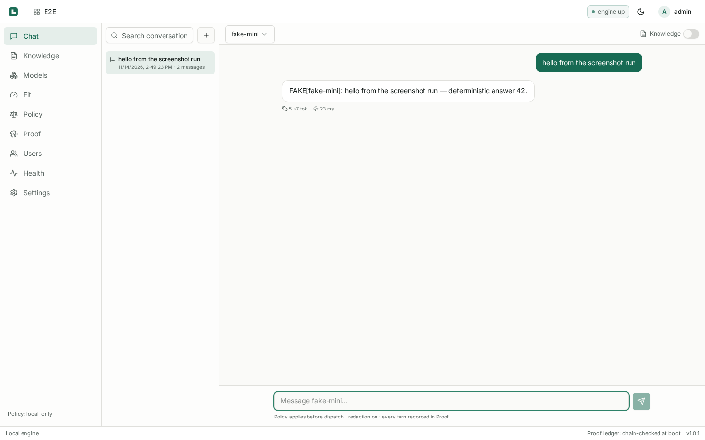
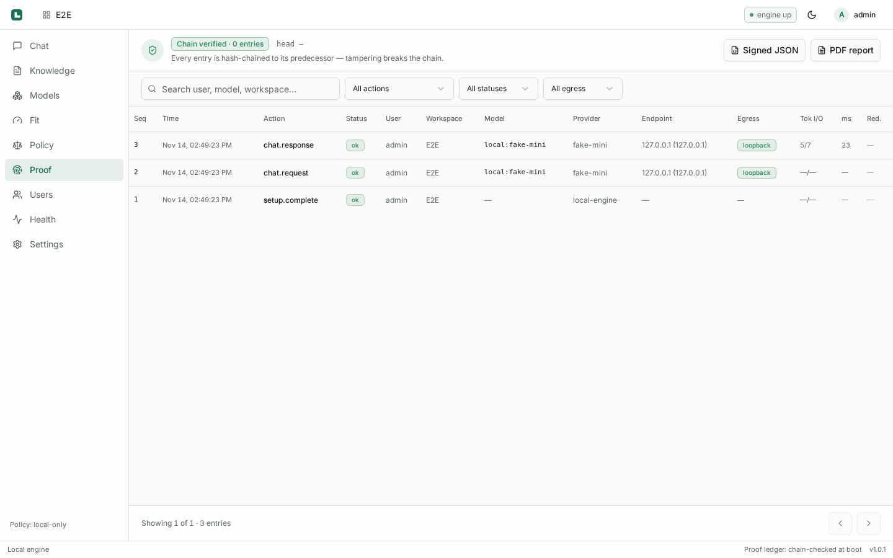
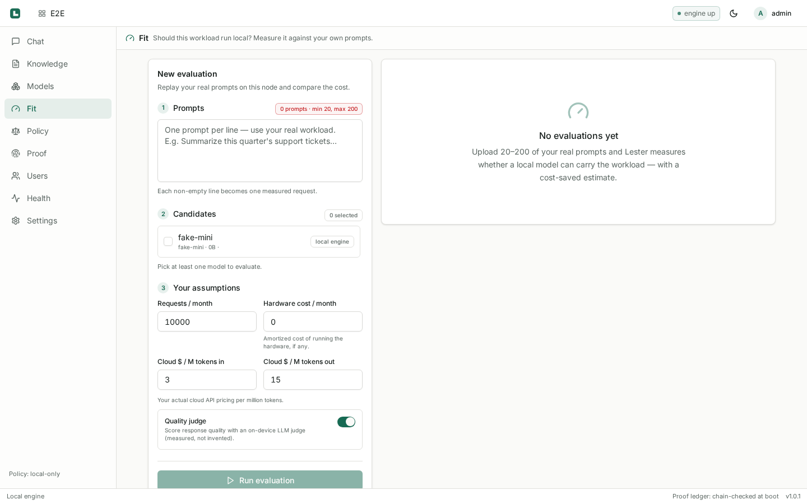
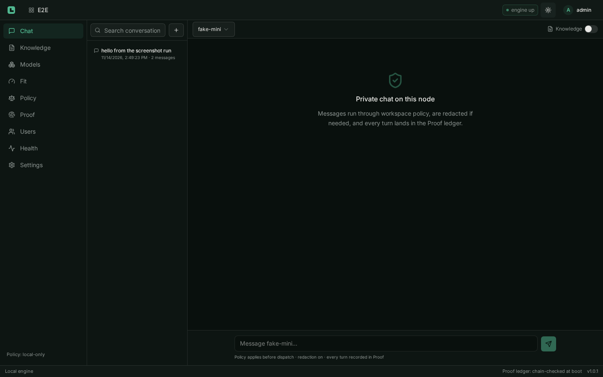
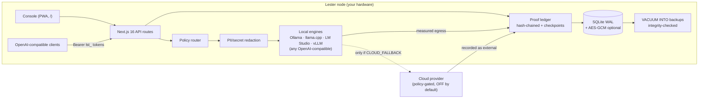

# Lester

**Your AI. Your hardware. Your proof.**

[](https://github.com/sufirumii/lester/actions/workflows/ci.yml)
[](LICENSE)

Lester is a **private AI control plane** that runs on your own hardware. One install gives you a
working, governed, auditable local-AI system built on small language models — with optional,
policy-gated cloud fallback that is **off by default**.

The problem it solves: teams want local AI for privacy and cost reasons, but a bare model runtime
gives you no governance, no audit trail, no policy, and no answer to "did any of this leave the
machine?". Lester is the layer between your users and the engine that provides all of that.

| | |
|---|---|
| **Lester Proof** | A hash-chained ledger of every request: which model handled it, where it ran (DNS-resolved, not assumed), whether any byte left the machine. Signed exports (JSON + auditor PDF) verify offline. |
| **Lester Fit** | Run 20–200 of *your own* prompts against candidate models. Measured latency, throughput, quality — and a clearly-labeled cost-saved **estimate** from your own pricing assumptions. |
| **Policy router** | Per-workspace rules: local-only (default), cloud fallback, or full block — with PII/secret redaction before dispatch and connect-time egress enforcement. |
| **Hardware-aware setup** | First run scans CPU/RAM/GPU/disk (cross-platform, no shell strings) and recommends models that actually fit. |
| **Local engines, first-class** | Ollama, llama.cpp `llama-server`, LM Studio, vLLM, or any OpenAI-compatible endpoint — auto-detected on common ports, with setup guidance when none is found. |
| **Always-on durability** | SQLite WAL + FULL sync, `VACUUM INTO` consistent backups with integrity checks, safe restore with pre-restore snapshots, crash recovery, optional encryption at rest. |
| **OpenAI-compatible API** | Point existing apps at one URL — they inherit policy, redaction and Proof. Verified by tests using the official OpenAI SDK. |

---

## 60-second quick start (Docker)

```bash
unzip lester-v1.0.2.zip && cd lester-v1.0.2
docker compose up -d
# open http://localhost:8090
```

With a local Ollama sidecar (pulls a small model on first run):

```bash
docker compose --profile with-ollama up -d
```

Both work with **zero edits**: Lester auto-detects the Ollama sidecar, Ollama on the host, or a
local engine port. The port is published on `127.0.0.1` only — see the deployment section of [docs/guide.md](docs/guide.md) for the
documented LAN opt-in.

> No Docker? `bash install.sh` (Linux/macOS) or `.\install.ps1` (Windows), then
> `bun run start:prod` → http://localhost:8090. Details in [docs/guide.md](docs/guide.md).

## First run

1. Open the Console. The **hardware scan** runs immediately (real CPU/RAM/GPU/disk numbers).
2. Create the admin account (local, scrypt-hashed; 10+ chars, common passwords rejected).
3. Connect an engine — detected automatically if Ollama/LM Studio/llama.cpp/vLLM is running;
   if none is found the wizard shows per-engine setup instructions and lets you continue without
   one (configure later in Settings → Engine).
4. Chat. Every turn shows tokens, latency, and its Proof ledger sequence number.

## Day-to-day

- **Chat** — streaming, saved + searchable conversations (per-user), model switcher, citations from your documents, safe markdown rendering.
- **Knowledge** — upload TXT/MD/CSV/JSON/LOG (≤5 MB each, ≤500 per workspace); chunking + BM25 retrieval runs on-device; retrieved text is treated as untrusted data (prompt-injection hardened).
- **Models** — registry with hardware-fit indicators, admin approvals, catalog installs through Ollama.
- **Fit** — the evaluation wizard; measured vs assumed is always visually separated and labeled as an estimate.
- **Policy** — rules with plain-language descriptions + a live "try the router" tester.
- **Proof** — filterable ledger (members see their own entries; auditors see all), chain verification, signed JSON/PDF exports, offline verifier, signed checkpoints.
- **Users** — admin / member / auditor roles, enforced server-side on every route (role matrix in docs/security-model.md).
- **Health** — engine status, throughput, storage, backup status, chain integrity, bind address.

## Use your existing apps

Create a named API token (Settings → API tokens — stored hashed, shown once, revocable), then:

```python
from openai import OpenAI
client = OpenAI(base_url="http://localhost:8090/api/v1", api_key="lst_…")
r = client.chat.completions.create(model="<model-key>", messages=[{"role": "user", "content": "Hi"}])
```

Requests pass through the same policy, redaction and Proof pipeline as the Console. The test
suite exercises this endpoint with the **official OpenAI SDK** (streaming and non-streaming)
against the real server.

## Screenshots (captured from the real app by the verification run)

| Chat — streamed, citations live | Proof — the ledger |
|---|---|
|  |  |

| Fit — measured vs assumed | Dark mode |
|---|---|
|  |  |

All four were captured by the live verification session against the production build.

## Architecture



Full request path, storage, egress details and the design-decision log: [docs/api-architecture.md](docs/api-architecture.md).

## Honest threat model and limits

Lester assumes the operator controls the host. Within that assumption:

- **Confidentiality** — prompts stay local *by default*; cloud is opt-in per workspace policy and every call is recorded. Engine destinations are resolved through DNS at connect time and enforced (public IPs refused for local-only requests; cloud-metadata/link-local always refused).
- **Auditability** — the Proof chain covers seq + timestamp + content hash (v2), so edits, deletions, reordering and timestamp tampering are all detectable. **Limit:** someone with full disk access can rebuild and re-sign the chain — signed checkpoints (exportable/anchorable off-host) make that detectable; anchor one elsewhere if you need that guarantee.
- **Integrity** — backups are consistent snapshots (`VACUUM INTO`), integrity-checked and chain-verified; restores take a pre-restore safety snapshot first.
- **Encryption at rest** — optional AES-256-GCM for message content, always-on for cloud API keys. **Limit:** the SQLite file itself is not whole-file encrypted; the key lives on the same host unless you point `LESTER_MASTER_KEY_FILE` elsewhere.

Details, role matrix and known gaps: [docs/security-model.md](docs/security-model.md).

## Documentation

| Doc | What's inside |
|---|---|
| [docs/guide.md](docs/guide.md) | Quick start, every environment variable, laptop/server/air-gapped deployment, operations runbook, troubleshooting, font license |
| [docs/security-model.md](docs/security-model.md) | Threat model, role matrix, limits |
| [docs/proof-and-fit.md](docs/proof-and-fit.md) | How Proof works, how to verify, checkpoints; how cost-saved is computed (editable assumptions) |
| [docs/api-architecture.md](docs/api-architecture.md) | OpenAI-compatible API reference, architecture, design-decision log |
| [SECURITY.md](SECURITY.md) | How to report security issues privately |
| [CONTRIBUTING.md](CONTRIBUTING.md) | Dev loop, honest-claims policy, code of conduct |

## Commands

| Command | What it does |
|---|---|
| `bun run start:prod` | Build (if needed) + migrate (with pre-upgrade backup) + serve on `http://127.0.0.1:8090` |
| `bun run dev` | Development server (port 3000) |
| `bun run test` | 65+ tests: durability, policy, redaction, Proof tamper (edit/delete/reorder/truncate/timestamp), auth/throttle/tokens, license, migrations upgrade, backup/restore, SSRF, pipeline, **OpenAI-SDK e2e against the real server** |
| `bunx tsc --noEmit` | Type check (strict; no errors ignored) |
| `bun run lint` | ESLint |
| `bun run migrate` | Apply migrations safely (fresh → all; v1.0.0 → baseline + upgrade, data intact) |
| `bun run backup` / `bun run restore <file>` | Consistent, integrity-checked backup / safe restore |
| `bun run keys:export [--passphrase '…']` | Export key material for off-machine recovery |
| `bun run admin:recover -- --user admin --new-password '…'` | Offline admin password recovery |
| `bun run license:issue -- --key <vendor.pem> --node <id>` | Issue a team license (vendor key only) |
| `bun run license:devkey` | Contributor dev keypair for local testing |
| `bun run proof:verify -- report.json` | Verify a Proof export offline |
| `bun run package` | Build `dist/lester-v1.0.2.zip` + `SHA256SUMS` (also generates THIRD_PARTY_LICENSES.md into the package) |

## Licensing — honest limits

- **Free tier** — 1 user, 1 workspace, every feature. No key needed, works fully offline.
- **Team tier** — per-node, N users. Keys are Ed25519-signed by the vendor key pinned in source
  and node-bound; activation and verification are 100% offline.
- **What licensing cannot do:** Lester is open source (Apache-2.0). Anyone with the source can
  patch out license verification — no open-core license system can prevent that. The license
  gates honest builds and the commercial relationship (support, compliance packs, updates).
  The intended model: open-source core, paid support and compliance packs, licensed team features.

## Roadmap

- v1.1 — PDF/Office knowledge ingestion; workspace membership model; embedded-model catalog
- v1.2 — Multi-node Proof anchoring (checkpoint exchange between nodes)
- v1.3 — SSO/OIDC (explicitly not "coming soon" UI-wise until it ships)

## About the author

Lester is built by [Rumi](https://github.com/sufirumii). Feedback, deployments and volume
licensing: open an issue or a GitHub discussion.

## Repository layout

```
src/app/            Console (single-page app at /) + the API (one catch-all route + handlers)
src/lib/            Engines, policy, redaction, Proof, knowledge, storage, licensing (merged modules)
prisma/             schema + real migrations (never db push)
brand/              Logo, marks, social preview
packaging/site/     Static marketing site (self-hosted font, no trackers)
scripts/            cli.ts (backup/restore/verify/recover/keys/licenses/migrate/icons/test/vendor) + start-prod, postbuild, package
tests/              65 tests in three merged unit files + Playwright e2e (config in tests/)
docs/               guide, security model, proof & fit, api & architecture (+ 4 screenshots)
```

The whole repository is under 100 files (95 committed files in v1.0.2) so it can be
uploaded to GitHub in a single web drag-and-drop.

## License

Apache-2.0 — see [LICENSE](LICENSE). Third-party licenses are generated into the release package by `bun run licenses:report` (see `THIRD_PARTY_LICENSES.md` inside the ZIP).
